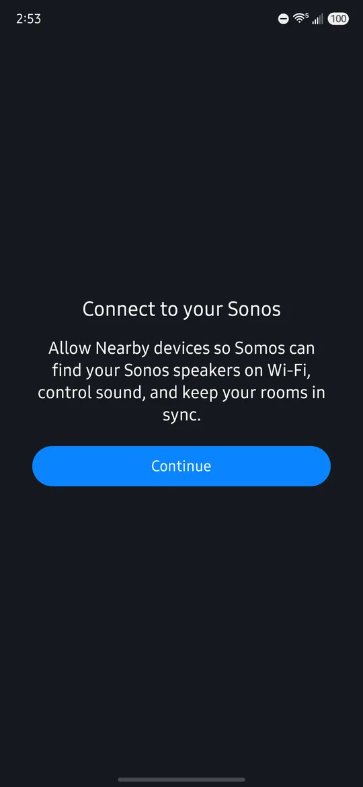
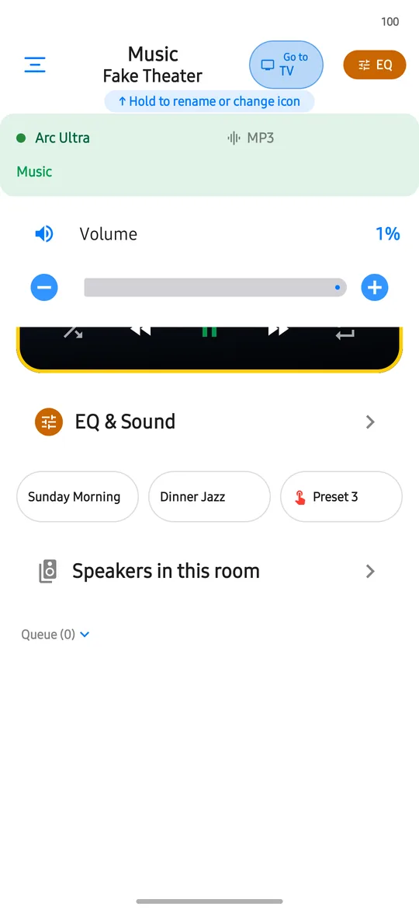

Open Somos InControl on Android, watch the short intro video, and the app searches your Wi-Fi for Sonos® speakers and opens your first room. You don't need a Sonos® account or any prior setup.

<Note>
  Somos needs your phone on the **same Wi-Fi as your speakers**. On Android 17 or later it also asks for the **Nearby devices** permission, which is how it finds and controls them. See [Android Permissions](/android/permissions).
</Note>

## Download and set up

<Steps>
  <Step title="Join the Google group">
    Somos InControl for Android is in a closed test on Google Play. Open **[groups.google.com/g/somos-android-testers](https://groups.google.com/g/somos-android-testers)** and join the group with the **same Google account the Play Store on your phone uses**.
  </Step>
  <Step title="Become a tester">
    Open **[play.google.com/apps/testing/com.cmoore.somosincontrol](https://play.google.com/apps/testing/com.cmoore.somosincontrol)** and tap **Become a tester**. Give it a few minutes before you install from Play.
  </Step>
  <Step title="Install and open">
    Install **Somos InControl** from Google Play and open it. If you already have it from Play, it updates on its own.
  </Step>
  <Step title="Lock Screen controls">
    On Android 13 or later, Somos asks whether to allow notifications for speaker controls. Choose **Continue** to answer Android's prompt, or **Not now**. Finding your speakers works either way. See [Lock Screen and Widgets](/android/lock-screen-and-widgets).
  </Step>
  <Step title="Find your speakers">
    Connect the phone to your speakers' Wi-Fi. Somos searches automatically and opens your first room. On Android 17 or later, allow **Nearby devices** when Android asks. Somos doesn't request Location or Bluetooth.
  </Step>
</Steps>

<Frame caption="The Connect to your Sonos page, shown before Android's Nearby devices prompt on Android 17 or later. Test build.">
  
</Frame>

Every discovered room appears automatically. Soundbars add the TV and home theater controls, and bonded subs add the subwoofer controls. Hold a room tab for options and grouping. Choose **Reorder**, drag the tabs, then tap **Done**. See [Your Rooms](/rooms/overview).

<Frame caption="A room page on Android: the room and its audio format, volume, and the three sound presets under EQ & Sound. The rooms in these pictures are test rooms.">
  
</Frame>

## If Somos can't find your speakers

Check the same four things as on iPhone, and then tap **Try Again**:

1. **UPnP on in the Sonos® app.** Sonos app › Account › Privacy & Security › UPnP › on.
2. **VPN allows your home network.** If the Sonos app works with your VPN on, Somos will too.
3. **Phone on the same Wi-Fi as the speakers.** Not cellular.
4. **Not a guest or IoT network.** Those keep devices from seeing each other.

You can also open the menu and choose **Your Sonos → Rescan My Network**.

## Help after setup

Open the menu and tap **Help & Support**. It has **Settings Somos needs** (the four checks above), a first-launch guide for Android, and **Somos Bookworm** for help. On Android, settings and favorites stay on this phone.

<Tip>
  Found something that doesn't look right? Write to cjmo.app@gmail.com. A screenshot plus the room name is all that's needed.
</Tip>
