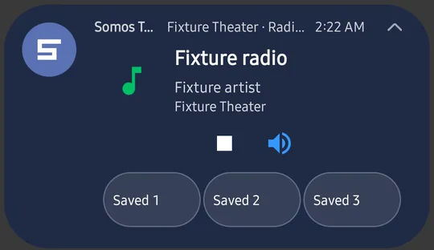
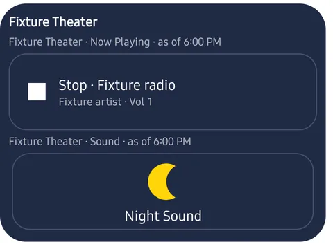

On iPhone this is the Live Activity and the Home Screen widget. On Android the same idea is a notification card and Android widgets.

## The Lock Screen and notification shade card

The card follows what the speaker is doing: a TV card for a room on TV, a music card with the title, artist and the playback buttons for a room playing music. Under the controls are the room's **three sound presets**, by name. Tap one to apply it. If the card is small, expand it for the full set of controls.

<Frame caption="The notification shade card for a music room, with the room's three presets under the controls. Test room and example data.">
  
</Frame>

At large font sizes the card gives the title and room more space and shows the presets in a single row. A very long preset name can be cut off in that row. This card needs notifications allowed; see [Android Permissions](/android/permissions).

## Home Screen widgets

Add a widget the usual Android way: long-press the Home Screen, choose **Widgets**, and look for **Somos**. There are three:

- **Somos – Presets** for a room's preset buttons
- **Somos – Mute** for a one-tap mute
- **Somos – Rooms & Volume** for switching rooms and changing volume

<Frame caption="A Somos widget with the room's now-playing line and a Night Sound button. Test room and example data.">
  
</Frame>

<Note>
  Android doesn't have Siri or the Shortcuts app. See [What is different on Android](/android/differences).
</Note>
