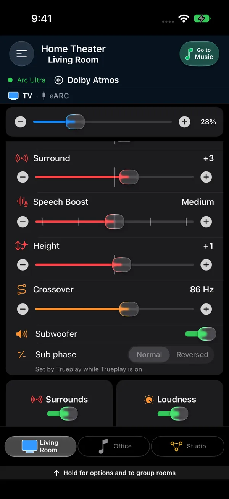
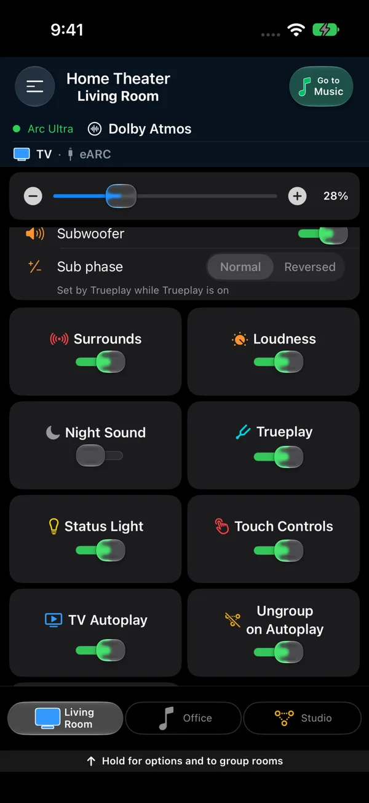
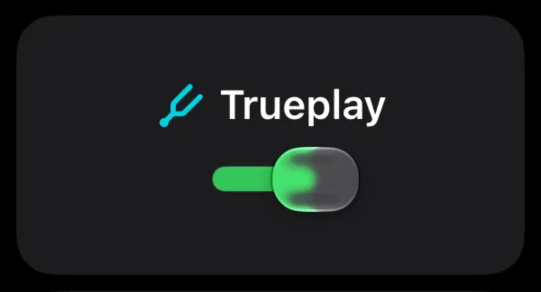

The sound card in Somos InControl lets you tune every Sonos® room. On Home Theater it sits below the TV presets. On Music, the orange sliders button in the title bar opens the same controls in a navy half sheet, under the three music preset pills; tap it again to close the sheet. Controls follow the room's hardware.

## Sliders

| Slider | Range | Appears when |
|---|---|---|
| **Bass** | −10 to +10 | Every room (on the music page in a room without a soundbar) |
| **Treble** | −10 to +10 | Every room (on the music page in a room without a soundbar) |
| **Balance** | left ↔ right | Stereo pairs |
| **Surround** | −15 to +15 | Surround speakers are bonded |
| **Speech Boost** (level) | Off / Low / Medium / High / Max | Soundbars that support dialogue levels (Arc Ultra); other soundbars get the on/off tile below |
| **Height** | −10 to +10 | A height-capable soundbar (Arc family, Beam Gen 2, Beam Ultra) or Era 300 satellites |
| **Subwoofer** | −15 to +15 | A Sub is bonded |
| **Crossover** | 50–110 Hz | A Sub is bonded and the room's speaker reports a crossover |

A lone slider stays centered in wide layouts. Sliders update the speaker live as you drag. If a slider snaps back, the speaker rejected the value — usually because Trueplay is active for that control, the room is in a group, or the connection dropped for a moment.

Rooms with a Sub get a **Subwoofer** on/off switch that silences the Sub without unbonding it. Rooms with surrounds have a **Surrounds** on/off switch in the sound sheet on [Music](/features/music#switches-in-the-sound-sheet); Home Theater no longer has one.

{/* <!-- screenshot needed: 40.0.10 Home Theater sound sliders without the Surrounds switch (the picture below still shows it) --> */}

<Frame caption="A soundbar room on iPhone, scrolled to the sound sliders: Surround (red), Speech Boost as a level, Height, Crossover in hertz, then the Subwoofer switch and Sub phase. Briefly hold a slider before you drag it, so a scroll through the page doesn't change the sound. (This picture is from an earlier build, which still had a Surrounds switch here.)">
  
</Frame>

## Sub phase

Every room with a Sub — a Sub, a Sub Mini, any generation — has a **Sub phase** switch under the Subwoofer on/off switch, with two positions: **Normal** and **Reversed**. It is the same setting the Sonos® app calls Sub Phase. Flip it and the bass changes at once; if the Sub sounds thin or hollow from where you sit, try the other position and keep the one that sounds fuller.

Two things to know:

- While **Trueplay** is on for the room, the switch is greyed out with the note **Set by Trueplay while Trueplay is on** — Trueplay chooses the phase for you. Turn Trueplay off and the switch comes back.
- The switch waits for the speaker to report its phase before it can be used, so it may spin for a moment when the page opens. If the speaker refuses a change, the switch goes back and a message says which phase the speaker kept.

Sub phase is not part of a preset.

<Frame caption="Sub phase under the Subwoofer switch. Left: greyed out while Trueplay is on. Right: Trueplay off, set to Normal.">
  
</Frame>

## Toggles

<CardGroup cols={2}>
  <Card title="Loudness" icon="volume-high">
    Adds bass and treble at low listening volumes so quiet music still sounds full. Available in every room that reports it.
  </Card>
  <Card title="Night Sound" icon="moon">
    Soundbar rooms only. Tames loud peaks for late-night viewing. See [Home Theater](/features/home-theater).
  </Card>
  <Card title="Speech Boost" icon="comment">
    Soundbar rooms only. Lifts dialogue above effects and music. On the Arc Ultra it is the level slider above instead of a tile.
  </Card>
  <Card title="Trueplay" icon="waveform">
    Shows the room's calibration state and lets you switch it on or off once the room has been tuned — see below.
  </Card>
  <Card title="Status Light" icon="lightbulb">
    Turns the speaker's white status LED on or off. Applies to every unit in the room, so one flip covers a stereo pair or a whole home theater.
  </Card>
  <Card title="Touch Controls" icon="hand-pointer">
    Enables or locks the touch/capacitive controls on the speakers in the room — handy with small children or curious cats.
  </Card>
</CardGroup>

The switch tiles line up in even rows and share a height that grows to fit larger text. On iPhone they sit two to a row, and an odd one sits small and centered on its own row. On iPad they sit three to a row upright and four on its side, with a short last row centered.

On the [Music page](/features/music), the switches are in the sound sheet, two to a row, with an odd last one on the left. **Status Light** and **Touch Controls** are here too. Rooms with surrounds have the **Surrounds** on/off switch and the **Surround Music** tile side by side on one row. **TV Dialog Sync**, **TV Autoplay** and **Ungroup for TV** stay on Home Theater.

Every switch card has a thin outline, and its title stays on one line unless you use the largest text sizes. The on/off switches answer to a taller touch than they look.

While you scroll through Music, rows stay in place as speaker readings arrive. Any new rows appear after scrolling stops. A control stays unavailable until its reading is ready.

{/* <!-- screenshot needed: 40.0.10 Music sound sheet switch grid with Surrounds and Surround Music on one row --> */}

On Home Theater, a grouped soundbar also has a **Group Audio Delay** stepper (see [Grouping Rooms](/rooms/groups)).

{/* <!-- screenshot needed: 40.0.10 Home Theater switch tiles: Loudness, Night Sound, Trueplay, Status Light, Touch Controls, TV Autoplay and Ungroup for TV, no Surrounds tile --> */}

<Frame caption="The switch tiles on a soundbar room in an earlier build. In 40.0.10 the Surrounds tile has moved to the sound sheet on Music, and Ungroup on Autoplay reads Ungroup for TV.">
  
</Frame>

## Trueplay

Trueplay is Sonos®'s room-calibration feature. When it's active, the speaker's sound is tuned to the acoustic properties of the room it's in. The Trueplay tile in the toggle grid shows one of three states:

- **Tuned** — the room has been calibrated. The tile is an on/off switch, and flipping it applies immediately.
- **Trueplay ↗** — the speaker supports Trueplay but hasn't been calibrated yet. The tile shows the Trueplay title with an arrow; tap it to open the official Sonos® app, which is the only place the microphone-based calibration can run.
- **Why not?**: Trueplay is blocked. Tap **Why not?** for the reason when it is offered. Separate front speakers prevent tuning until you remove them. Some products, including Port, Connect and Roam SL, do not support room calibration.

The Trueplay title and explanation wrap inside the card at larger text sizes.

{/* <!-- screenshot needed: 40.0.10 Trueplay tuned, Trueplay ↗ and Why not? cards, at default and larger text sizes --> */}

<Info>
  Bonding separate front speakers to a soundbar (something only Somos InControl offers) makes Trueplay unavailable for that room. This is a Sonos® firmware restriction that the app cannot work around. You can keep the wider soundstage, or remove the fronts to get Trueplay back — the app warns you about this trade-off before it bonds fronts.
</Info>

<Frame caption="The Trueplay tile shows the room's Trueplay state. Where a tuning profile exists it is an on/off switch; otherwise the tile links to the Sonos app, where tuning is done.">
  
</Frame>

## Sound settings follow the source

On a soundbar, Somos InControl keeps a separate set of sound values for **TV** and for **Music**. Switch the source with the pills at the top of the room page and the sliders move to the values you last used for that source; the TV presets on the room page and the music presets on the music page are separate for the same reason.

While **Music** is lit on a soundbar, the sound card leaves the room page altogether. The room page keeps its header and volume, and the music controls are on the [music page](/features/music). Open it there with the orange sliders button in the title bar. Tap it again to close it. Tap **TV** on the room page to bring back the TV sound card.

A room with no soundbar only plays music, so its bass, treble, Sub level and Loudness live on Music. A stereo pair also has **Balance** in its Music sound sheet. Its room page still has Balance, the Sub's on/off switch, **Crossover** and **Sub phase**, and the Trueplay, Status Light and Touch Controls switches. The Sub and surround rows are still available for rooms that have them. See [TV rooms and music rooms](/rooms/overview#tv-rooms-and-music-rooms).

## Staying in sync

Every control reads back from the speaker. A silent background resync runs about every 30 seconds so the app never drifts far from what the Sonos® app or your TV remote did, and you can pull down on the room page to force a full refresh.
