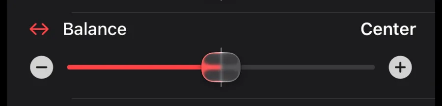

Every room has a **music page**. On a soundbar, tap **Go to Music** in the title bar of the room page; on any other room, tap **Music** at the top of its page. A room that is already playing music opens on this page. From here you browse your music services and play straight to the room — the speaker streams from the service itself, and your phone is only the remote. The page is titled **Music** with the room's name under it, so you always know which room you are playing to.

## What's on the music page

Volume stays at the top. Below it, the page scrolls from the services and full player to **EQ & Sound**, the preset pills and **Speakers in this room**.

<CardGroup cols={2}>
  <Card title="Pinned volume" icon="volume-high">
    The room's volume slider stays pinned at the top and collapses to a slim bar as you scroll, just like the room page.
  </Card>
  <Card title="Favorites and your music services" icon="music">
    **Favorites**, **Playlists** and **Queue** sit above the music services. Swipe the service row sideways to see more services and **Manage services**. If none are set up, tap **Add a music service**. These rows scroll up with the page; you do not need to open a **Tap to browse** row first. When a cable is plugged into a speaker's Line In, a **Line In** tile comes first (see [Line In](#line-in)). The lit service is the one playing. See [Music Services](/features/music-services) and [Favorites & Queue](/features/favorites-and-queue).
  </Card>
  <Card title="The player" icon="play">
    Album art, title, artist, a progress bar you can drag, and **Shuffle**, **Previous**, **Play/Pause**, **Next** and **Repeat**. Play resumes the queue rather than just un-pausing. When what is playing came from one of your services, a **heart** and a **plus** sit beside the title — keep it, or add it to the queue or one of your playlists. See [Add the playing song to a playlist](/features/favorites-and-queue#add-the-playing-song-to-a-playlist). A radio station shows the station's name as the title and, underneath, what the station says is on right now. A title too long for the line scrolls instead of being cut off.
  </Card>
  <Card title="Go to TV" icon="tv">
    On a soundbar, **Go to TV** in the title bar takes you back to Home Theater. It changes the page you see. To send the bar back to its TV input, tap **Back to TV** when it is offered, or go to Home Theater and tap **Switch to TV**. See [Home Theater](/features/home-theater#two-pages-for-a-soundbar-room).
  </Card>
  <Card title="EQ & Sound" icon="sliders">
    Tap **EQ & Sound**, or the EQ button on the full or mini player, to open the controls in place. Tap again to close them. The sliders come first, with the switches at the bottom of the EQ card. Controls follow the room's hardware: bass, treble, Sub level, Balance, Height and Music Level where available. Sub and surround controls are still here for rooms that have them. See [EQ & Trueplay](/features/eq-and-trueplay).
  </Card>
  <Card title="Music presets" icon="star">
    Three compact preset pills sit below **EQ & Sound**, without a **Sound Presets** heading. These are separate from a soundbar's TV presets. Tap to load; hold to save or rename. Long names scroll, and an empty slot has a hold-to-save symbol. See [Sound Presets](/features/sound-presets).
  </Card>
  <Card title="Speakers in this room" icon="speaker">
    Below the presets, tap **Speakers in this room** to open or close the speaker map. Press and hold the map to configure the room. See [Room Diagram](/rooms/room-diagram).
  </Card>
  <Card title="Queue" icon="list">
    Tap **Queue** above the services to see what is coming up next. The current track is highlighted. Tap a track to jump to it, swipe left to remove it, or tap **Clear** to empty it (the app asks first). **Search Queue** filters the list. See [Favorites & Queue](/features/favorites-and-queue#the-queue).
  </Card>
</CardGroup>

{/* screenshot needed: 40.0.7 Music page with the services, full player, EQ & Sound, three preset pills and Speakers in this room; a second view with the mini player pinned below volume and EQ open */}

## The mini player and seek bar

Scroll down and the player shrinks to a mini player pinned just under volume. **Previous**, **Play/Pause**, **Next**, **Shuffle**, **Repeat** and **EQ** stay within reach. Tap its art or title to return to the full player. Shuffle shows whether it is on; Repeat cycles through **Off**, **All** and **This song**. Both players show the same state. A radio station greys out controls it cannot use.

For a seekable song, drag the full player's progress bar and hold it where you want. The thumb and elapsed and remaining times follow your finger. Let go to play from that point. While the song plays, the thumb and times advance without shifting the player card.

The Music EQ keeps its rows in place while you scroll, even if more speaker settings finish loading. New rows appear once scrolling stops. Controls wait for a speaker reading before you can use them. A loading symbol may settle to a still hourglass while the read continues.

## Switches in the Music EQ

Open **EQ & Sound** to reach **Loudness**, **Trueplay**, **Surround Music** (with surrounds), **Status Light** and **Touch Controls**, where the room supports them. They sit at the bottom of the EQ card and close with it.

On a soundbar room, **TV Dialog Sync** is here too. It reads the soundbar's setting even if you open Music first. **Off** removes the delay; **On** restores the last nonzero delay, or the first step if none has been saved. To choose the exact delay, use the **TV Dialog Sync** stepper on Home Theater. **TV Autoplay** and **Ungroup on Autoplay** stay on Home Theater.

## When the room is grouped

The music page of a grouped room shows who it is grouped with (for example **Office grouped with Era Right S**) and the **Group** slider under the room's own volume, just like the room page. Its presets are the group leader's. See [Grouping Rooms](/rooms/groups).

## Browsing and playing

<Steps>
  <Step title="Tap a music service">
    The music page slides down out of the way, leaving a handle at the bottom that shows what is playing, and the service's own page opens above it — its shelves, rows and stations, laid out the way the service asks.
  </Step>
  <Step title="Find something">
    Scroll the service's page, open an album or a playlist in place, or use the **Search** field at the top — it searches with the service's own categories (songs, albums, artists, playlists, stations, whatever that service offers) and the results replace the page until you clear the field.
  </Step>
  <Step title="Play it">
    Tap a song, album, playlist or station. It plays on the room, and the music page comes back up with the player and the queue. Tap the **plus** on a song instead to add it to the end of the queue without interrupting what is playing; tap the **heart** to keep it in your Favorites.
  </Step>
  <Step title="Go back and forth">
    The handle at the top of the raised page reads **Back to browse** (or **Back to favorites**) — tap it or pull it down to return to the service's page. Pull the handle up to bring the player back. The handle is only there after you opened a service's page yourself; when music was started elsewhere and the service simply lit up, the player has no handle to go back to. The back arrow in the top-left corner returns to the room page.
  </Step>
</Steps>

<Note>
  Music playing, and you come back into the app or switch to that room? You land on the music page, not the home theater page. It only opens by itself while music is actually playing — never for TV, never when paused.
</Note>

## Line In

Speakers with a Line In — Era 100, Era 300, Move 2 (with its USB-C adapter), Five, Amp, Port and Connect, for example — can play whatever you plug into them. While the speaker reports a cable in, a **Line In** tile appears first in the row of music services. Tap it and the room plays its Line In. The tile steps aside while that room is already playing Line In, and comes back if you pause it. Without a cable, the tile isn't there.

There is no Line In pill on the room page. While a room plays Line In, its source line reads **Line In** (and **Bluetooth** while it plays over Bluetooth). Either way the room is on its Music side, so the music presets and music EQ on this page are the ones you tune. See [Your Rooms](/rooms/overview).

## Apple Music quality badges

For a song that came from Apple Music, small badges under the artist line say what Apple's catalogue offers for that track — **Lossless**, **Hi-Res Lossless**, **Dolby Atmos**. This is what the track offers, not what the speaker is decoding at that moment. The same format shows in the room page header while the music plays, in every room, and on the [Live Activity](/features/live-activity) music card. For other music, the header shows the stream's own format when it reports one, such as **MP3**, **AAC** or **FLAC**, the way a soundbar shows its TV audio. Somos asks for Apple Music permission the first time it needs this.

## Swipe the art to change songs

Off by default. Turn it on in the menu under **App → Somos settings → Swipe art to change songs**, then swipe the album art on the player **right for the next song, left for the previous**. See [Gestures](/features/gestures).

## Music-only surround controls

Rooms with surrounds get two extra controls that only apply to music, matching the Sonos® app's music-surround settings:

- **Music Level** — how loud the surround speakers play during music. Separate from the **Surround** level on the room page, which is for TV.
- **Surround Music** — a small tile with a switch between **Ambient** (left) and **Full** (right). **Full** plays the surrounds at full level for music; **Ambient** keeps them subtle. The tile only appears when surrounds are bonded to the room.

<Note>
  The Sonos® Favorites and Sonos® Playlists tiles from earlier builds are gone from the music page. Favorites in Somos are now your own (your playlists have a [backup](/features/playlist-backup) too) — anything you heart from a music service — and live on the [Favorites page](/features/favorites-and-queue). The [Apple Watch app](/features/apple-watch) still plays your Sonos® favorites.
</Note>

<Tip>
  Playback controls also live on the [Live Activity](/features/live-activity): play/pause, previous and next appear on the Lock Screen and in the Dynamic Island whenever the room is playing music.
</Tip>

<Frame caption="Top: Surround Music sets how the rear speakers play music, Ambient or Full. Bottom: a stereo pair has Balance on its music EQ page; move it toward the left or right speaker, or back to Center.">
  

  

  

  

</Frame>
