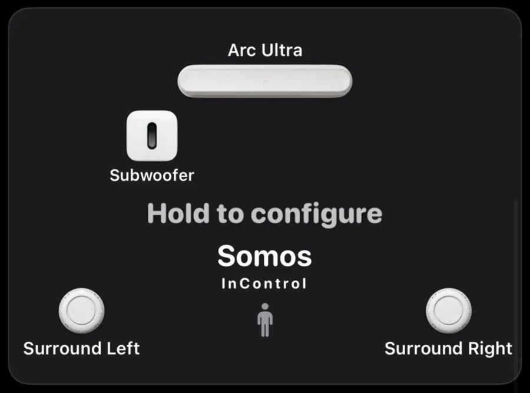

At the bottom of every room page, the room diagram gives you a live picture of the speaker topology in that room. Rather than just showing a name, it renders the actual layout — left and right units for stereo pairs, a subwoofer when one is bonded, and the front and surround satellites around a soundbar. It's a fast way to confirm you're looking at the right room and to see how it's configured before you start adjusting.

## What the diagram shows

From build 40.0.10 the diagram is a small picture of the room: a TV stand at the front, a sofa at the back, and pictures of your speakers where they sit. It has no labels.

<CardGroup cols={2}>
  <Card title="Stereo pair" icon="circle-half-stroke">
    Two speakers on the stand, turned in toward the sofa.
  </Card>
  <Card title="Single speaker" icon="circle">
    One speaker, centred on the stand.
  </Card>
  <Card title="Bonded subwoofer" icon="waveform">
    When a Sub is bonded to the room — soundbar or not — it sits beside the stand. A second Sub sits on the other side.
  </Card>
  <Card title="Soundbar with satellites" icon="tv">
    The soundbar on the stand, surrounds in the back corners either side of the sofa, and separate front speakers either side of the stand when bonded.
  </Card>
</CardGroup>

{/* <!-- screenshot needed: 40.0.10 room picture for a soundbar with Sub and surrounds, a stereo pair and a single speaker, light and dark --> */}

The diagram always shows what is *really* bonded, read from the Sonos® system. After a configuration change it updates on its own; if it lags, pull down to refresh — Sonos® can take up to a minute to propagate topology changes.

<Note>
  On Music, open the sound sheet with the orange sliders button in the title bar, then tap **Speakers in this room** to open or close the map. Press and hold the map to configure it, just as on the room page. On a soundbar, **Go to TV** returns to Home Theater, where the diagram is at the bottom of the page.
</Note>

{/* <!-- screenshot needed: 40.0.10 sound sheet with Speakers in this room open --> */}

## Press and hold to configure

<Tabs>
  <Tab title="Soundbar rooms">
    The picture carries a **Hold to configure** hint in large black letters, whether the bar is bare or fully built out (on a white pill in dark mode). Press and hold to open **Home Theater Setup**, where you assign fronts, surrounds and up to two Subs. See [Speaker Setup](/rooms/speaker-setup).
  </Tab>
  <Tab title="Single speakers and stereo pairs">
    Press and hold to open the **Stereo Pair** sheet. On a single speaker you pick a partner of the same model from the standalone speakers on your network and choose which one is left; on an existing pair you can reorder left/right or **Separate stereo pair**. The hold does nothing on a single speaker that has no matching partner available.
  </Tab>
</Tabs>

<Note>
  Stereo pairing and home theater bonding both happen inside Somos InControl — you don't need the official Sonos® app for either. If a configuration doesn't complete, the app restores your previous setup automatically.
</Note>

<Frame caption="The room diagram in an earlier build, with labels and a listener figure. From 40.0.10 it is a picture of the room with no labels. Press and hold it to open the setup page for that room.">
  
</Frame>
