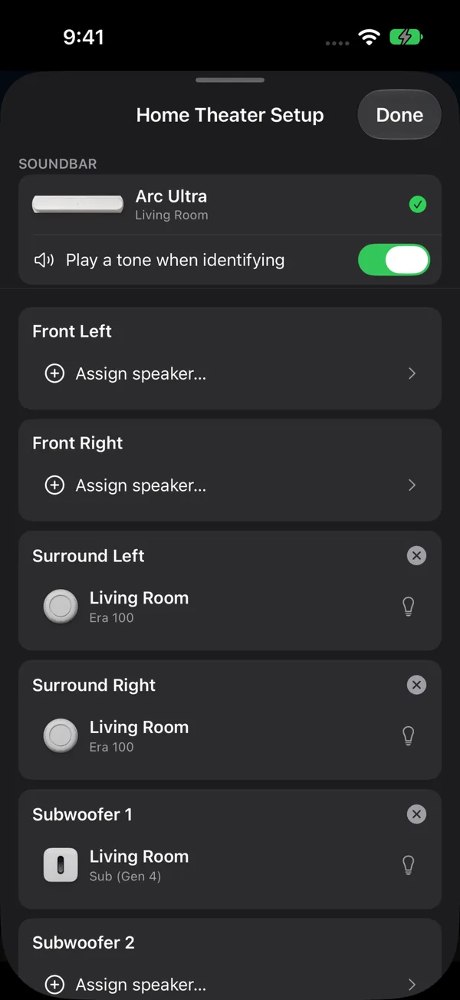
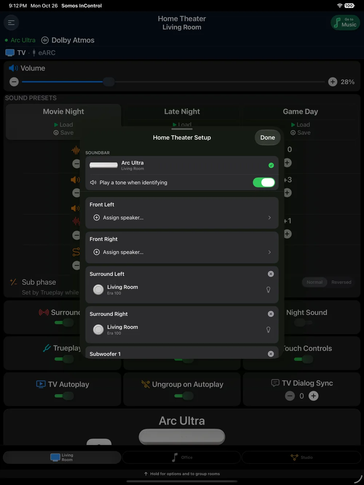

Somos InControl can build your rooms as well as control them. Press and hold the room diagram on any room page to open the setup sheet for that room: **Home Theater Setup** on a soundbar, or the **Stereo Pair** sheet on a single speaker or an existing pair.

<Warning>
  Set each speaker up in your Sonos® system first. Speakers already bonded elsewhere or in another group must be released before you assign them. You can choose an existing stereo pair for fronts or surrounds: Somos asks before separating it and uses both speakers together.
</Warning>

## Home Theater Setup (soundbars)

<Steps>
  <Step title="Open the sheet">
    On the soundbar's page, press and hold the room diagram.
  </Step>
  <Step title="Fill the slots you have">
    The sheet lists six slots: **Front Left**, **Front Right**, **Surround Left**, **Surround Right**, **Subwoofer** and **Subwoofer 2**. Tap a slot and choose from the available speakers or stereo pairs on your network. Sub slots only offer Subs. The picker explains compatibility on an **Arc Ultra** or **Beam Ultra**. Older models can appear too; the soundbar decides whether it accepts them. If you choose a stereo pair, confirm **Split this stereo pair?** before continuing. The **flash** button beside each candidate pulses that speaker's status light so you can tell which is which; by default it also plays a short identify tone, which you can turn off with **Play a tone when identifying**.
  </Step>
  <Step title="Mind the front-speaker rule">
    Fronts must be assigned as a pair — both or neither — and the app checks this when you apply. Surrounds and Subs can be assigned on their own. Tapping **×** on an assignment clears just that slot.
  </Step>
  <Step title="Apply and wait">
    Tap **Apply**. When you add separate fronts, Somos temporarily removes the attached speakers, adds the fronts and confirms them, then adds Sub and confirms it, then adds surrounds and confirms them. Without fronts, setup starts with Sub, then surrounds. The progress sheet shows each stage. Leave it open until the room settles; fronts take longer than a single bond.
  </Step>
</Steps>

To take everything off the bar, tap **Remove All Speakers**, or remove speakers one at a time with **×** and then **Apply**. Released speakers reappear as their own rooms (Sonos® can take up to a minute), and the app offers to rename them as they come back.

### Separate front speakers

Somos InControl lets you bond separate front left and right speakers to a soundbar — something the official Sonos® app doesn't offer. Know the trade-off before you do: the soundbar becomes the centre channel and some of its own drivers go quiet, the fronts receive steered channels rather than their own Atmos feed, and **Trueplay becomes unavailable** while fronts are bonded. The app shows **Before You Add Fronts** before you continue. **Don't show this again** remembers your choice.

<Note>
  A **Beam Ultra** accepts the front speakers but keeps its front and height channels, so the added fronts stay silent. The warning explains this before you continue. You can still choose **Add Fronts**. Its **Don't show this again** choice is remembered separately from the general fronts warning, including after you close and reopen setup.
</Note>

Separate fronts, surrounds, Subs and stereo pairs all work in your chosen room. Only the rooms beyond it, grouping and saved groups are part of [Whole Home](/getting-started/whole-home).

<Frame caption="Home Theater Setup: the soundbar with Play a tone when identifying, then Front Left, Front Right, Surround Left, Surround Right, Subwoofer 1 and Subwoofer 2. Each filled position has its own remove button and a bulb to identify the speaker; Remove All Speakers is at the bottom.">
  
</Frame>

{/* <!-- screenshot needed: 40.0.9 Home Theater Setup progress for fronts, then Sub, then surrounds; Beam Ultra warning with remembered opt-out --> */}

If a stage fails or you cancel, Somos attempts to restore the previous layout and reports what happened. Check the room diagram afterwards. If recovery does not finish, send **Submit diagnostics** from **Menu → Advanced Settings**. Status Light recovery follows your latest choice, including after a pair is split or restored.

## Stereo pairs

<Tabs>
  <Tab title="Create a pair">
    On a single speaker's page, press and hold the diagram. The **Stereo Pair** page starts with the held speaker and lets you pick a partner from the standalone speakers of the **same model** on your network. The two appear as cards, marked **LEFT** and **RIGHT** — the top card is always the left channel; press and hold a card and drag to swap them. The bulb beside each card flashes that speaker's light so you can tell which is which. Tap **Apply** to pair.

    <Frame caption="The Stereo Pair page: the top card is LEFT, the bottom card is RIGHT.">
      
    </Frame>
  </Tab>
  <Tab title="Separate a pair">
    On a stereo pair's page, press and hold the diagram and tap **Separate stereo pair**. Both speakers come back as their own rooms, and the app offers to rename them.
  </Tab>
</Tabs>

<Note>
  The hold does nothing on a single speaker that has no same-model partner available on the network — there's nothing to pair it with.
</Note>

## Things to know

- **Trueplay after bonding.** Sonos® firmware blocks Trueplay on a bar with separate fronts. Run Trueplay in the official Sonos® app before adding fronts if you want it, and expect it to read *Unavailable* afterwards.
- **A released speaker doesn't come back.** Sonos® can hold a stale bond until the speaker restarts. Unplug it for 10 seconds and plug it back in.
- **The diagram didn't update.** Pull down on the room page; the app also resyncs every 30 seconds or so.
- **A pair with a Sub is still a music room.** Bonding a Sub to a stereo pair or a single speaker adds the Sub's level, switch, crossover and phase — it does not add TV controls or TV presets. Only a soundbar gets those. See [TV rooms and music rooms](/rooms/overview#tv-rooms-and-music-rooms).

<Frame caption="Home Theater Setup on iPad: the same positions and assignment controls on the larger screen. Identify a speaker before changing the position it fills.">
  
</Frame>
